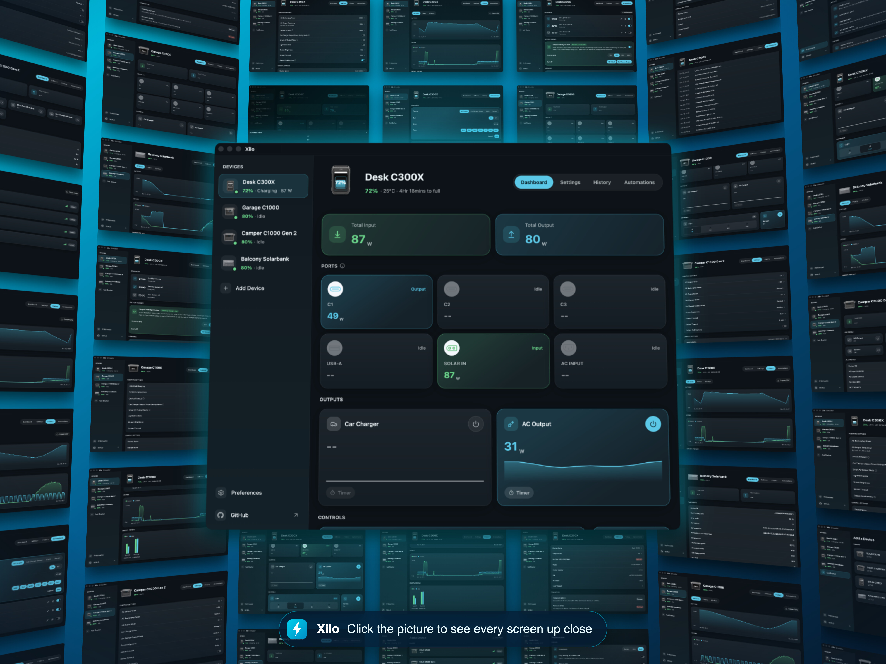
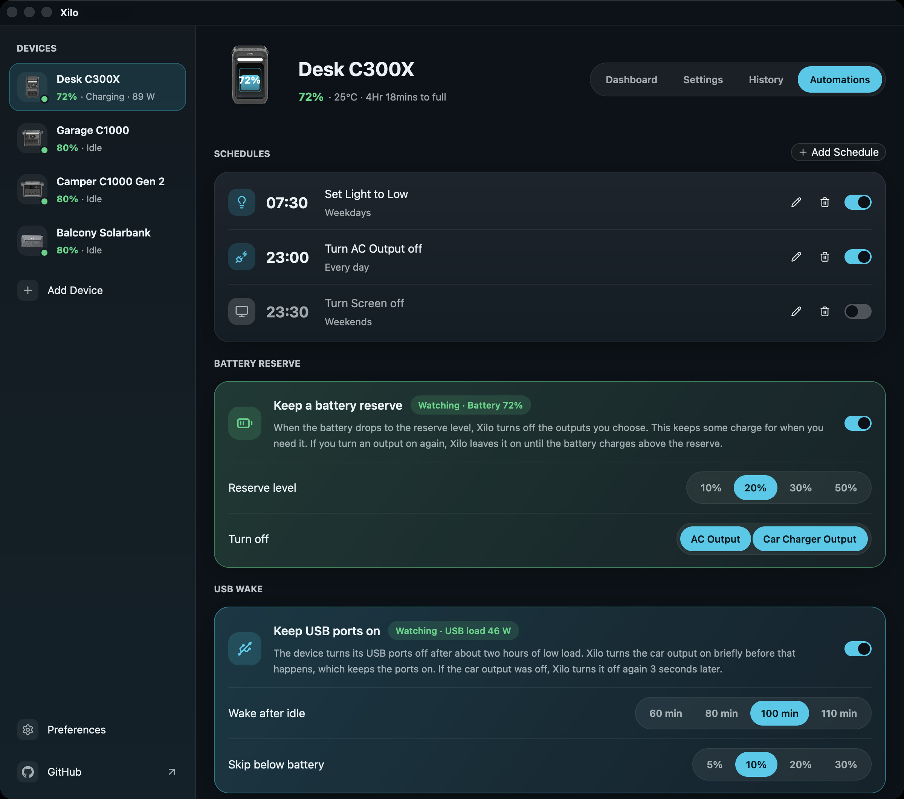

# Xilo



Xilo is a desktop app for Anker SOLIX devices. It talks to them over Bluetooth only. You don't need an account, a cloud connection or the internet.

**Website and documentation: [ftchd.github.io/xilo](https://ftchd.github.io/xilo)**

Xilo is not made by or affiliated with Anker.

## Features

- **Dashboards** for the C300X and C1000 that follow the Anker app: battery, temperature, remaining time, port status, AC and car outputs with live graphs, light and screen controls, and error messages.
- **Every setting** from the Anker app, with option lists and limits checked before anything is sent. Risky changes (AC frequency, factory reset) ask for confirmation, and each one is written to an audit log.
- **38 models** in total. Models without their own dashboard get a generic one with all decoded values.
- **Automations**: schedules, a battery reserve, USB wake and alerts. See [Automations](#automations).
- **History**: battery and power every 10 seconds, stored on this Mac. It includes charts, energy per day and CSV export.
- **Menu bar**: battery level in the menu bar, quick AC and car output toggles, and "release to phone" so the Anker app can connect.
- **Inspector** (developer mode): raw and decrypted frames, a per-message diff, redacted capture files and a guarded raw command console.
- **`xilo`**: the same engine on the command line.

## Automations

Xilo can look after your devices while it runs, in its window or in the menu bar. Each device has its own Automations tab.



- **Schedules**: turn the AC output, the car output or the screen on or off, or set the light, at a set time on the days you choose. You can pause a schedule without deleting it.
- **Battery reserve**: when the battery drops to 10, 20, 30 or 50% while it discharges, Xilo turns off the outputs you choose. If you turn an output on again, Xilo leaves it on until the battery charges above the reserve. A schedule doesn't turn an output on while the battery is at the reserve.
- **USB wake**: some devices, like the C300X, turn their USB ports off after about two hours of low load. Xilo switches the car output on briefly before that happens, which keeps the ports on. If the car output was off, Xilo turns it off again 3 seconds later.
- **Alerts**: errors, low battery, a chosen charge level (80, 90 or 100%), AC power lost and back, and devices out of reach for 10 minutes. They show in the app and as system notifications. You choose them in Preferences.
- **Activity**: every automation and alert from the last 7 days, at the bottom of the tab.

Automations run while Xilo is open or in the menu bar, and the device is in Bluetooth range. If a device is out of range when a schedule is due, Xilo waits up to 10 minutes, then notes the schedule as missed.

## Supported devices

| Kind            | Models                                                                                                                                                                                                                      |
| --------------- | --------------------------------------------------------------------------------------------------------------------------------------------------------------------------------------------------------------------------- |
| Power stations  | C300, C300X, C300 DC, C300X DC, C200(X), C200 DC, C200X DC, C800, C800 Plus, C800X, C1000(X), C1000 Gen 2, C1000X Gen 2, C2000 Gen 2, C2000X Gen 2, S2000, F1200, F1500, F2000, F2000 Plus, F2600, F3000, F3800, F3800 Plus |
| Solarbanks      | E1600, 2 Pro, 2 AC, 2 Plus, 3 Pro, 4 Pro                                                                                                                                                                                    |
| Home            | Home Power Panel                                                                                                                                                                                                            |
| Prime and other | Prime Charger 160W and 250W, Prime Power Bank 20K, MagGo 3-in-1, Prime Charging Station 240W, EverFrost 2 40L and 58L                                                                                                       |

Protocols: ZX with ECDH and AES-CBC, ZX Gen 2, Prime with AES-GCM, the older AES key exchange, and the 2540 GATT service.

## Command line

You can find `xilo` in `Xilo.app/Contents/Helpers/` on macOS and in `bin/` on Windows and Linux.

```sh
xilo scan
xilo --name C300X status
xilo --name C300X watch --secs 600
xilo --name C300X set light_mode 1
xilo --name C300X set ac_frequency 60 --confirm
xilo --name C300X capture --secs 30 -o c300x.xcap
xilo --sim A1723 status            # simulated device, no Bluetooth
xilo models
```

## Contributing

See [CONTRIBUTING.md](CONTRIBUTING.md) for building, development and the layout of the code.

## License

Xilo is under the [MIT License](LICENSE). It includes work from [anker-solix-api](https://github.com/thomluther/anker-solix-api) and [SolixBLE](https://github.com/flip-dots/SolixBLE), which are also under the MIT License. Their notices are in [NOTICE](NOTICE).
